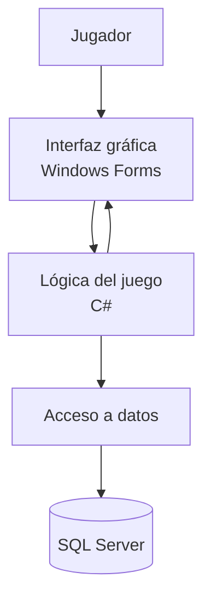

# Arquitectura propuesta de NEXUS

## 1. Objetivo

El objetivo es mejorar el videojuego NEXUS desarrollado en C#, pasando de una aplicación de consola a una aplicación con interfaz gráfica. También se propone utilizar SQL Server para guardar las partidas y permitir que el jugador continúe donde se quedó.

## 2. Tecnologías

- **C#:** lenguaje utilizado para programar el juego.
- **Windows Forms:** permitirá crear ventanas, botones y mostrar el mapa.
- **SQL Server:** servirá para guardar las partidas y el progreso.
- **GitHub:** permitirá almacenar y organizar el código del proyecto.

## 3. Partes principales del sistema

La nueva versión estará organizada en tres partes.

### 3.1. Interfaz gráfica

Será la parte que verá el jugador. Tendrá un menú principal, un mapa, el inventario y una pantalla para los combates.

Se utilizarán ventanas y botones para que jugar sea más sencillo y visual.

### 3.2. Lógica del juego

Será la encargada de controlar las reglas de NEXUS, como el movimiento, la vida, la energía, los enemigos y las misiones.

Se aprovecharán las clases que ya existen en H3, como `Cadete`, `Personaje`, `Robot`, `Enemigo` y `Mapa`.

La clase `SistemaNexus` también se aprovechará, pero se podrá organizar mejor para que no tenga que controlar todo el juego por sí sola.

### 3.3. Base de datos

SQL Server permitirá guardar la información necesaria para continuar una partida.

Se guardarán datos como la vida y energía del cadete, su posición, el inventario y el progreso de las misiones.

Para organizar las operaciones se podrán crear clases que permitan guardar y recuperar las partidas.

## 4. Diagrama de arquitectura

El siguiente diagrama muestra cómo se comunicarán las partes del juego:

El jugador interactúa con la interfaz gráfica. La interfaz envía las acciones a la lógica del juego, que procesa los resultados. Cuando sea necesario guardar o cargar una partida, se utilizará SQL Server.

## 5. Relación con el código actual

| Código actual | Mejora propuesta |
|---|---|
| `Personaje` | Mantener la clase base de los personajes. |
| `Cadete` | Conservar los datos y recursos del jugador. |
| `Robot` y `Enemigo` | Seguir utilizándolos en los combates. |
| `Mapa` | Adaptarlo para mostrar el escenario gráficamente. |
| `SistemaNexus` | Organizar mejor las funciones del juego. |
| `partida_nexus.json` | Pasar progresivamente el guardado a SQL Server. |

## 6. Desarrollo por etapas

Para que el proyecto sea posible de realizar, se dividirá en etapas:

1. Revisar y corregir los errores de la versión actual.
2. Crear el menú y la pantalla del juego en Windows Forms.
3. Conectar la interfaz con las clases existentes.
4. Crear la base de datos y las funciones para guardar y cargar partidas.
5. Añadir las tres misiones nuevas y probar que todo funcione.

Primero se mejorará la misión que ya existe, «La anomalía perdida». Después se desarrollarán «Señal en la oscuridad», «El guardián de NEXUS» y «El origen de la brecha».

## 7. Justificación

Esta arquitectura permitirá mejorar NEXUS sin tener que programarlo todo desde cero. Se reutilizará el código que ya funciona y se añadirán las nuevas características poco a poco.

Separar la interfaz, las reglas del juego y la base de datos hará que sea más fácil encontrar errores y realizar cambios en el futuro.

## 8. Fuentes consultadas

- Microsoft Learn. Documentación de Windows Forms: https://learn.microsoft.com/en-us/dotnet/desktop/winforms/
- Microsoft Learn. Documentación de acceso a SQL Server desde .NET: https://learn.microsoft.com/en-us/sql/connect/ado-net/sql/

Las tecnologías y la arquitectura descritas son propuestas para la futura versión de NEXUS. Todavía deben implementarse y probarse.
