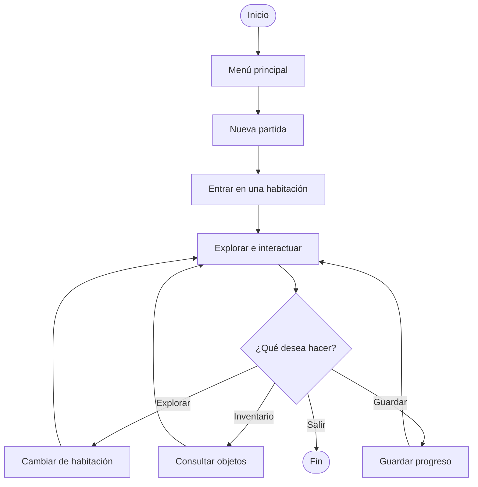
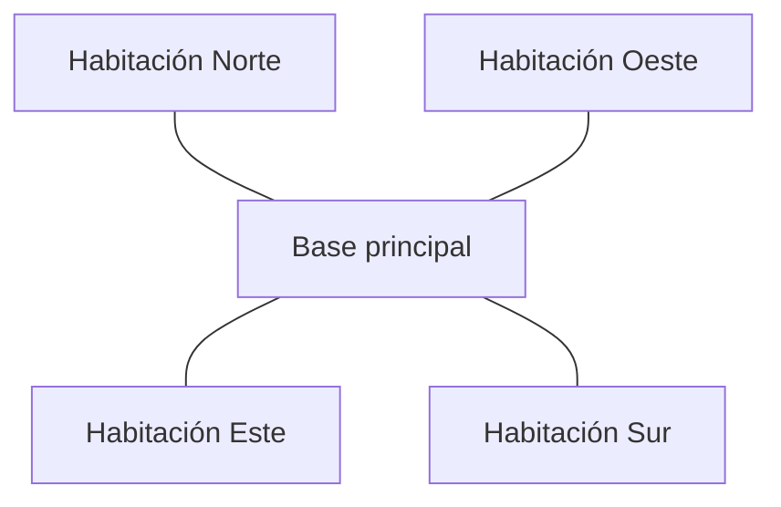
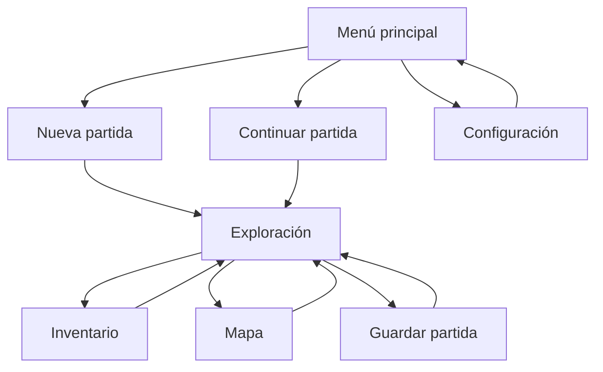
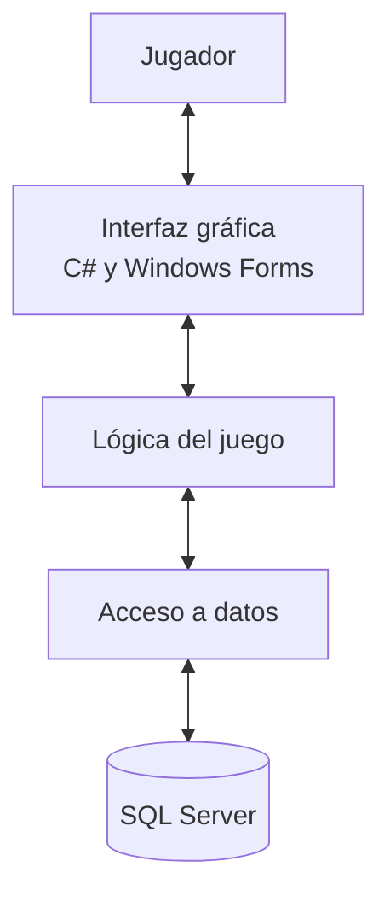
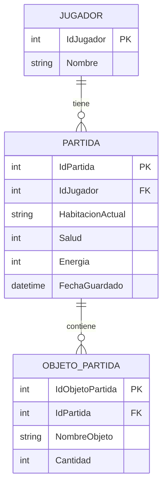

# Diagramas de diseño propuesto — NEXUS

## 1. Introducción

Este documento presenta los diagramas iniciales para la evolución de NEXUS, tomando como base el videojuego desarrollado en H3.

La propuesta busca transformar progresivamente el juego en una aplicación de escritorio desarrollada en C# con Windows Forms, manteniendo las mecánicas de exploración e interacción y considerando SQL Server para la persistencia de las partidas.

Los siguientes diagramas representan un diseño propuesto, no funcionalidades que ya estén implementadas.

## 2. Diagrama de flujo del juego

El siguiente diagrama representa el recorrido básico del jugador desde el inicio hasta la exploración.

## 3. Diagrama del mapa de habitaciones

El mapa representa una distribución sencilla de cinco habitaciones conectadas. El jugador podrá desplazarse entre las habitaciones que tengan una conexión.

La base principal funciona como punto central del mapa. Las demás habitaciones pueden contener descripciones, objetos o interacciones, según las mecánicas que se definan para el juego.

## 4. Diagrama de navegación entre pantallas

Este diagrama muestra las principales pantallas previstas para la versión de escritorio.

La interfaz propuesta permitirá acceder a las opciones principales mediante botones y regresar a la pantalla de exploración sin perder el estado de la partida.

## 5. Diagrama de arquitectura propuesta

La arquitectura separa la interfaz gráfica, la lógica del juego y el almacenamiento de datos.

### Componentes

- **Jugador:** utiliza las opciones de la aplicación.
- **Interfaz gráfica:** presenta los menús, el mapa, el inventario y el estado del jugador.
- **Lógica del juego:** controla el movimiento entre habitaciones, las interacciones y los recursos.
- **Acceso a datos:** gestiona las operaciones de guardado y recuperación.
- **SQL Server:** almacena la información persistente de las partidas.

Esta arquitectura es una propuesta para las siguientes etapas y deberá adaptarse al código existente de H3.

## 6. Modelo de datos inicial

El siguiente modelo muestra una posible estructura para guardar jugadores, partidas y objetos del inventario.

Este modelo es preliminar. Los atributos y las relaciones deberán revisarse según las clases, las mecánicas y los datos que realmente utilice NEXUS.

## 7. Alcance de la propuesta

Los diagramas establecen una guía inicial para el diseño y la implementación futura del videojuego.

Las prioridades propuestas son:

1. Diseñar el menú principal en Windows Forms.
2. Crear una pantalla de exploración sencilla.
3. Representar las habitaciones y permitir el desplazamiento entre ellas.
4. Incorporar el inventario y el estado del jugador.
5. Diseñar el guardado y la recuperación de partidas mediante SQL Server.

La implementación deberá conservar la coherencia con el proyecto H3 y evitar introducir mecánicas que no correspondan al videojuego existente.

## 8. Estado actual

**Estado:** diseño propuesto.

Los diagramas documentan una posible evolución de NEXUS. No implican que todas las pantallas, mecánicas o conexiones con SQL Server estén implementadas actualmente.
