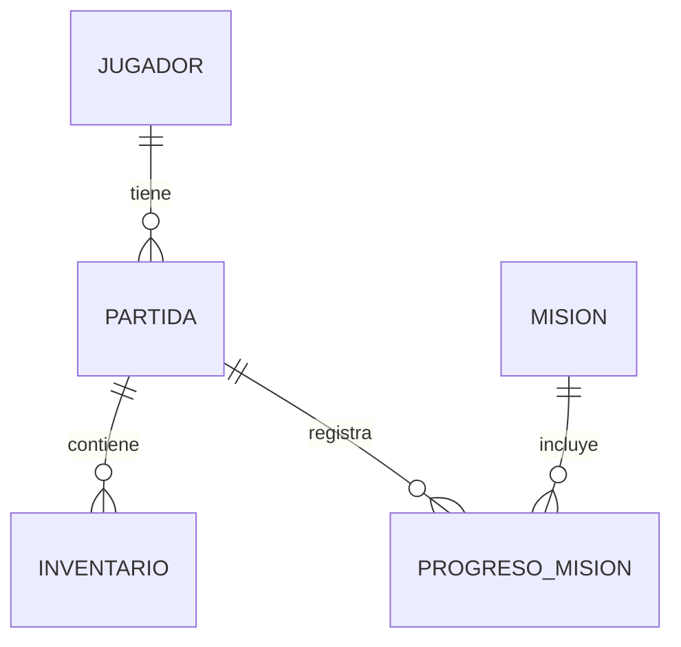

# Modelo de datos propuesto de NEXUS

## 1. Objetivo

El objetivo es diseñar una base de datos para guardar y recuperar el progreso del jugador en NEXUS. Se utilizará SQL Server para conservar la información de las partidas y permitir que el jugador continúe donde se quedó.

## 2. Información que guardará el sistema

### 2.1. Jugador

Guardará los datos básicos del jugador.

- Nombre del cadete.
- Edad del cadete.

### 2.2. Partida

Almacenará el estado actual de la partida.

- Vida actual del cadete.
- Energía disponible.
- Posición del cadete en el mapa.
- Misión actual.
- Fecha y hora del último guardado.

### 2.3. Inventario

Guardará los objetos que posee el jugador.

- Nombre de cada objeto.
- Cantidad disponible.

### 2.4. Misiones

Contendrá la información de las misiones principales del videojuego.

- Nombre de la misión.
- Descripción de la misión.

Las cuatro misiones propuestas son:

1. La anomalía perdida.
2. Señal en la oscuridad.
3. El guardián de NEXUS.
4. El origen de la brecha.

La primera misión ya está desarrollada en la versión actual. Las otras tres se añadirán durante las siguientes etapas del proyecto.

### 2.5. Progreso de las misiones

Permitirá conocer el avance del jugador en cada misión.

- Nombre de la misión.
- Estado de la misión: pendiente, en curso o completada.

## 3. Organización de la información

La información se organizará en diferentes tablas para que sea más fácil consultarla y actualizarla.

Cada partida tendrá información sobre el jugador, su inventario y el progreso de las misiones. De esta manera, el sistema podrá recuperar los datos necesarios para continuar el juego.

## 4. Diagrama del modelo de datos

## 5. Cómo se guardará una partida

Cuando el jugador seleccione la opción «Guardar partida», el sistema almacenará su información en SQL Server.

Se guardarán la vida, la energía, la posición en el mapa, los objetos del inventario y el progreso de las misiones.

## 6. Cómo se recuperará una partida

Cuando el jugador seleccione «Cargar partida», el sistema recuperará la información almacenada en SQL Server.

De esta manera, podrá continuar desde el último guardado sin tener que comenzar una partida nueva.

## 7. Relación con la versión actual

Actualmente, NEXUS utiliza el archivo `partida_nexus.json` para guardar algunos datos del cadete.

En la nueva versión se propone utilizar SQL Server para organizar y conservar más información, incluyendo el inventario y el progreso de las misiones.

El cambio se realizará poco a poco, aprovechando el código que ya existe.

## 8. Consideraciones finales

Este modelo es una propuesta inicial que se ajustará durante el desarrollo del proyecto.

Se realizarán pruebas para comprobar que la información pueda guardarse y recuperarse correctamente.
